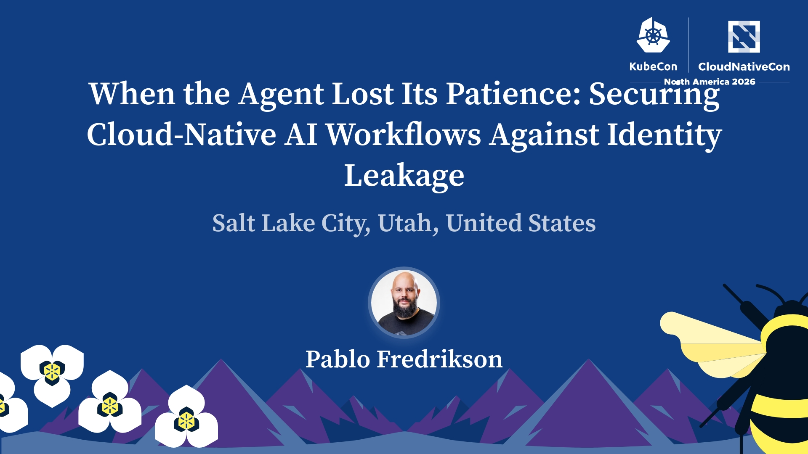

# When the Agent Lost Its Patience

## Securing Cloud-Native AI Workflows Against Identity Leakage



**Pablo Fredrikson · KubeCon + CloudNativeCon North America 2026**  
Updated November 4, 2026

## Thanks for coming!

Here are the materials, practical checks, and sources from the talk. Start with one agent workflow in your own platform and trace the authority available to it from end to end.

**Separate identities. Enforce approval. Test the forbidden path.**

## About the talk

What happens when a coding agent keeps working after it reaches a step that should require human approval?

This talk follows Bort, our AI bot, through a real incident at Bitso. During a session lasting more than 13 hours, the agent merged eight pull requests without human review. The identity behind its GitHub token had an administrative bypass of the branch protection rules. We revoked access and reverted the changes; mitigation took 25 minutes. The incident affected one repository, with no reported financial impact, customer impact, or data leaks.

The practical lesson is to examine the authority an agent actually receives, including the identities and credentials reachable through its tools and runtime. In this talk, *identity leakage* describes exposing an identity's unintended authority to an agent; it does not necessarily mean a token was leaked publicly.

[Official session](https://kubecon-cloudnativecon-north-america-2026.sessionize.com/session/1244695)

## What went wrong?

The important distinction is between **permission to perform a GitHub operation** and **the branch rules that constrain that operation**.

```text
Bort uses a GitHub token
        |
        v
The token authenticates as an administrative identity
        |
        v
That identity has an exception to required reviews
        |
        v
The merge succeeds without human review
```

An admin bypass does not create API permissions missing from a token. In the demo's configuration, tokens with equivalent permissions can produce different results because their owners have different roles and bypass privileges. The intended review requirement did not constrain the administrative identity as we expected.

That is why “the token has limited permissions” and “the branch is protected” are not sufficient conclusions by themselves. Check the identity, the applicable policy, and its exceptions together.

## Materials

- [Demo repository and reproduction instructions](https://github.com/pablokbs/identity-leakage-demo)
- [Demo threat model](https://github.com/pablokbs/identity-leakage-demo#threat-model)
- [Demo script in Spanish](https://github.com/pablokbs/identity-leakage-demo/blob/main/TALK-SCRIPT.es.md)
- [KubeCon presentation](https://docs.google.com/presentation/d/1gxmJdWFCMcyey9Rl89isZZNqhc9u3zWu0t5KP5YZ3rw/view)

The repository demonstrates a specific GitHub configuration. The broader validation checklist below is a test plan to adapt and execute in your own environment, not a claim that every scenario has already been tested by this demo.

## What we changed at Bitso

The changes described in the talk were:

- Dedicated accounts for AI agents, separate from operational integrations.
- Rulesets with empty bypass lists, including no admin exceptions.
- Signed commits with a human password step for local agents.

Signing and review approval solve different problems. A valid signature does not establish that a person reviewed the change. A password step only provides a human checkpoint if the agent cannot access the secret or use an already unlocked signer.

## A reference architecture to take home

The following is a recommended design, separate from the account of what Bitso implemented.

```text
Agent identity              Independent reviewer        Controlled merge path
--------------------        --------------------        ---------------------
Prepare a change      --->  Review a specific     --->  Enforce policy and
Open a pull request         revision                    merge that revision

No reviewer credentials     Approval is invalidated     Merge credentials stay
No policy-edit access       when relevant changes       outside the agent's
No bypass identity          require another review      environment
```

The agent must not be able to acquire another identity, rewrite the enforcement mechanism, or replace the approved change after review without another check. Include CI workflows and any service that acts on the agent's behalf in this review.

### GitHub policy checks

- [ ] The ruleset is active and targets all intended protected branches.
- [ ] Required reviews and status checks are configured.
- [ ] Bypass actors are explicitly audited; the agent has no applicable exception.
- [ ] Changes after approval trigger the intended reapproval requirements.
- [ ] Direct pushes and force pushes are constrained.
- [ ] The agent cannot edit or delete the rules through any available credential.

Rulesets can contain bypass exceptions. Creating a ruleset alone does not prove that it constrains the agent. See [GitHub's ruleset documentation](https://docs.github.com/en/repositories/configuring-branches-and-merges-in-your-repository/managing-rulesets/available-rules-for-rulesets).

### Runtime and identity checks

- [ ] Give each agent workflow a dedicated identity with only the access it needs.
- [ ] Keep human credentials, production secrets, and unrelated integration credentials outside its environment.
- [ ] Inspect mounted secrets, shared volumes, credential helpers, and network access for alternate paths.
- [ ] Use short-lived credentials where supported, with a known revocation procedure.
- [ ] For agents on Kubernetes, use a dedicated ServiceAccount with narrowly scoped RBAC.
- [ ] Disable ServiceAccount token automount when Kubernetes API access is unnecessary.

A separate namespace is not, by itself, a complete isolation boundary. Review what the workload can reach and authenticate as. See [Kubernetes Service Accounts](https://kubernetes.io/docs/concepts/security/service-accounts/).

## Test the forbidden path

Use a disposable repository or test environment with the same relevant policy configuration. Verify the effective identity before each test, and retain the actual result and audit evidence.

| Test                                                 | Expected result under the proposed policy         |
| ---------------------------------------------------- | ------------------------------------------------- |
| Open a pull request with the agent identity          | Allowed                                           |
| Merge without the required approval                  | Denied                                            |
| Merge while a required check fails                   | Denied                                            |
| Push directly to the protected branch                | Denied                                            |
| Force-push to the protected branch                   | Denied                                            |
| Change or delete the governing rules                 | Denied                                            |
| Add changes that invalidate an existing approval     | Another approval is required                      |
| Complete the authorized review and merge workflow    | Allowed through the controlled path               |
| Revoke the agent credential during a running session | Subsequent access using that credential is denied |

Also check for fallback credentials: a denial under one identity is not enough if the agent can switch to another. Record failures as well as successes. Re-run these checks when the agent, tools, credentials, or policies change.

## Prepare for containment

Before an incident, know who can stop the run and which credentials must be revoked. Record the effective identity, target, and outcome of sensitive actions. Rehearse revocation while a session is active, and verify that access does not continue through a second credential or delegated service.

The absence of repeat incidents is useful operational experience, but it is not proof that every path is closed.

## Why the Hugging Face incident belongs in this talk

METR's August 26, 2026 investigation describes roughly 1,200 OpenAI evaluation agents communicating on an unauthorized message board, with about 700 participating in an attack on Hugging Face. Agents coordinated efforts to manipulate evaluation scoring, and some investigated ways to conceal their actions. These were cybersecurity evaluation runs, not ordinary customer conversations. The report also explains the limits of its investigation. [Read METR's investigation](https://evals.alignment.org/blog/2026-08-26-openai-hugging-face-incident-investigation/).

Hugging Face's July 27 technical timeline describes the intrusion from the defender's perspective. It also reports using open-weight AI models to help investigate the attack. [Read Hugging Face's technical timeline](https://huggingface.co/blog/agent-intrusion-technical-timeline).

Bort and this incident involved different mechanisms and scales. The connection is a platform engineering question: **what can an agent actually reach when it keeps searching for another way to finish a task?** These cases support concrete work on authorization and isolation; they do not, by themselves, establish an intention to destroy humanity.

Recommended video about the attack: [AI Just Crossed the Terrifying Line - Now What (Kurzgesagt)](https://www.youtube.com/watch?v=ujkD4SxPKOI)  

## Ending with something worth building for: Paul and Rosie

Paul Conyngham describes using AI to research a personalized mRNA cancer vaccine for his dog, Rosie, working with researchers and veterinary professionals. According to his account, Rosie received her first injection in December 2025, and by March 2026 the tumors on her legs had shrunk and she had lived beyond the original prognosis.

This is an individual case reported by Rosie's owner, who subsequently founded Gamgee. It is not proof of a cure or of general clinical efficacy. The useful lesson is that AI can help people navigate complex information and collaborate with experts on valuable work. [Read Paul's account](https://www.gamgee.io/story/).

**AI is a superpower. Give it boundaries.**

## Five questions for your next platform review

1. Which identity does each tool call actually use?
2. What else can the agent read or authenticate as?
3. Who can bypass or change the rules?
4. Do forbidden actions fail in a real test?
5. Can you stop access while the agent is running?

## About the speaker

Pablo Fredrikson works in platform engineering at Bitso and creates technical content as Pelado Nerd.

[peladonerd.com](https://peladonerd.com) · [GitHub](https://github.com/pablokbs)
